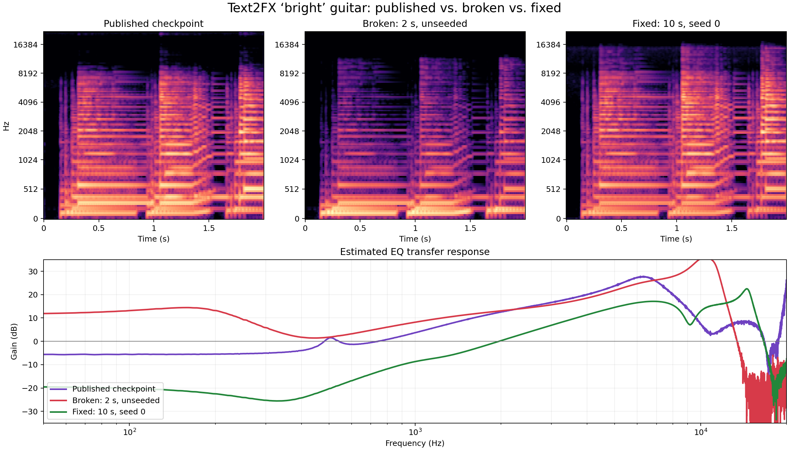

# Bright guitar inference diagnosis

## Symptom

A direct Text2FX run on `assets/guitar.wav` for `bright` produced an audibly
different result from the public `guitar_600.wav`. Its estimated EQ curve
boosted lows by roughly 13 dB, while the public example cut lows and emphasized
the upper mids.

## Reproduction signal

`inference/diagnostics/compare_eq_response.py` estimates each dry/wet transfer
function and compares them from 50 Hz to 20 kHz. The original local render had
a gain-aligned response RMSE of 12.121 dB against the public checkpoint.

## Root cause

The two invocations did not use equivalent inputs or reproducibility settings:

- The website's clean guitar is 10.242948 seconds. The repository's current
  `assets/guitar.wav` is exactly its first 2.008889 seconds. MS-CLAP repeats
  audio shorter than its seven-second window, so the optimizer received a
  different semantic input distribution.
- Plain Text2FX used three uncontrolled RNGs: Python for CLAP cropping, NumPy,
  and Torch for parameter initialization and circular rolling.
- The website repository's `experiment_log.txt` records 650 iterations, not
  600. `guitar_600.wav` is the iteration-600 checkpoint selected from that
  run. The log records no seed or Python crop sequence, so that exact optimizer
  trajectory cannot be reconstructed.

This was not a DSP-version failure. Applying the website's logged iteration-600
parameters with the current installed `dasp-pytorch` reproduced the published
EQ shape to 0.302 dB RMS after compensating for a constant gain difference.

## Fix

- Plain Text2FX now seeds Python, NumPy, and Torch after model construction and
  exposes `--random-seed`, defaulting to `0`.
- The SemantiFX CLI and adapter also default to seed `0`; the plugin runner
  passes it explicitly.
- The exact public clean input is preserved as Text2FX
  `assets/guitar_full.wav`.
- The plugin capture was increased from five to ten seconds, avoiding repeated
  audio in MS-CLAP's seven-second window.

The fixed 601-step run produced a low shelf of -19.31 dB and a +18.51 dB bell
at 6.93 kHz. Its gain-aligned response RMSE against the public checkpoint was
8.091 dB. That is not the unrecoverable historical trajectory, but it restores
the intended low-cut/high-boost direction and is exactly replayable.

The standalone's actual 50-iteration path was also checked end to end. It
returned -4.18 dB on the low shelf, +4.96 dB on the second bell, +3.94 dB on
the fourth bell, and +3.87 dB on the high shelf, with `random_seed: 0` recorded
in the protocol result.

Two independent one-iteration cold runs with seed `0` produced identical
parameter JSON (SHA-256
`bfc2fa8bc4595fbb540da845cf2cfcba19bd1bf3b3e915edadf2788afcfa75ab`).

## Source artifacts

- Public project page: <https://anniejchu.github.io/text2fx/>
- Public website source and logs:
  <https://github.com/anniejchu/anniejchu.github.io/tree/master/research/text2fx/audio/EQ_only/bright_guitar>
- Public output and the user's download share SHA-256
  `0f6a5d21da75f0be1eded42a42091ec761e7717483504e51f8a596d3180ff542`.

